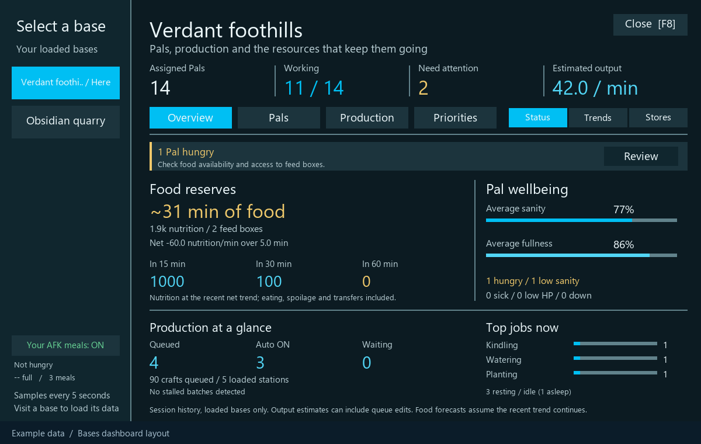

# Palworld AutoProduction: Bases

Manage your guild's loaded bases from the same menu as Inventory, Party and Guild. This UE4SS Lua mod includes workstation automation, a Pal roster, work priorities, food forecasts and automatic meals for an idle player. No separate priority mod is required.

**Public beta · Windows Steam · MIT license**

**Working tree: beta.2 candidate.** The production settings and stability changes below have automated coverage; live acceptance/performance testing and publication are pending. The download link still points to the published beta.1.

[Download the beta](https://github.com/PascalMeusel/PalworldAutoProduction/releases/tag/v0.1.0-beta.1) · [Report an issue](https://github.com/PascalMeusel/PalworldAutoProduction/issues) · [Changelog](https://github.com/PascalMeusel/PalworldAutoProduction/blob/main/CHANGELOG.md)

Tested during development on Windows Steam Palworld `v1.0.5.102999` with the Palworld UE4SS fork at `ba2efd55`. Single-player/local host is the primary target. Compatibility with other game versions and multiplayer setups is not established. Back up your world before trying a beta. Requires a separately installed compatible [UE4SS runtime](https://github.com/Okaetsu/RE-UE4SS); the release does not bundle a loader or game assets.

*Preview rendered from example data; the game supplies its own native background and fonts.*

The author has uploaded the beta to [Steam Workshop](https://steamcommunity.com/sharedfiles/filedetails/?id=3837541491). See the [packaging and update notes](https://github.com/PascalMeusel/PalworldAutoProduction/blob/main/docs/workshop.md); the candidate still needs validation through the Workshop loader.

## Open Bases

Press **F8** during gameplay, or click **Bases** on the main menu's native tab bar. You can switch directly to Party or another tab. **Escape**, **Close** or **F8** on Bases returns to gameplay. F8 also closes the menu after switching to another tab. Close a kitchen, storage or other interaction window first. The added screens support mouse input and native scrollbars; controller navigation inside the dashboard is not implemented.

The sidebar selects the base you're standing in by default and marks it **Here**. Real custom names are preserved; the game's unnamed template entries become **Base 1**, **Base 2**, etc. Rates and forecasts describe loaded objects in this session. Visiting a remote base brings its stations and feed boxes into scope.

## Read your base

| View | What it tells you |
| --- | --- |
| **Overview → Status** | Who needs care, how well Pals are fed, which jobs they are doing, which stations are waiting, and where feed reserves are heading in 15, 30 and 60 minutes. **Review** opens the relevant list. |
| **Overview → Trends** | Ten minutes of measured production, activity and feed reserves, plus a separate one-hour projection. Unreadable intervals stay blank. |
| **Overview → Stores** | Which foods are actually in the loaded feed boxes, how much nutrition each contributes, and how much stock entered or left between samples. |
| **Pals** | Scroll or filter **Working**, **Resting** or **Care**. Each row shows activity, health, sanity, fullness, a care warning and fixed assignment when available. Hunger and starvation use the game's state when readable. |
| **Production** | Scroll or filter **Queued**, **Auto** or **Waiting**. Each station has a building name, distance from the Palbox and a number if there are duplicates. See its recipe, queue, measured items/minute, estimated batch time and Auto Produce setting. |
| **Priorities** | Adjust the base defaults and individual Pal overrides for all thirteen work suitabilities. Hover a cell for its skill rank and current permission. |

## Plan food and ingredients

**Food reserves** count the nutrition of edible items already in loaded feed boxes. Ordinary chests, carried food and unfinished cooking queues are excluded. Food readings continue every five seconds while you are in your guild's base, including during normal play with Bases closed and automatic meals disabled. This reads feed boxes only when the full dashboard sampler sleeps. After two minutes of continuous readings, the mod estimates the net stock trend over up to five minutes. Steadily declining reserves get a time-to-empty estimate; flat stock says **No depletion observed**. A new session, an actual gap after leaving the base, changed feed-box sources or unreadable supplies can restart learning. Closing the menu or moving within the base does not stop food tracking. A volatile trend suppresses precise projections.

**Stores** also shows an *if deliveries stop* estimate after at least two observed losses. This uses recent withdrawals, including eating, spoilage and transfers; arrivals and withdrawals between the same two readings can offset one another. It is a planning scenario, not individual Pal calorie consumption.

**Production → Supplies** answers a different question: how long can this station keep making its selected recipe? While standing in the station's base, inspect the game's current craft limit, ingredients per craft, base stock, carried stock and the first ingredient to run out. **For full batch** lists how many more of each ingredient you need for your configured batch size. With a positive measured production rate, it estimates time to exhaust those inputs. The estimate assumes no new deliveries or competing uses. Already queued crafts are excluded. **Refresh** reads current stock; inspecting a recipe never queues anything.

## Use Auto Produce

At a supported workstation, select a recipe and click **Auto Produce** beside **Allow Transport by Pals**. **ON** is green. The normal transport checkbox keeps its own click target.

You can also use **Bases → Production** while standing in the station's base. Pick **Choose recipe** (or **Change** on an idle station), select an unlocked recipe, then click **OFF / Enable**. Recipe selection alone costs nothing. The game validates each batch. **ON / Pause** stops future refills and lets accepted crafts finish. To change an active automation's recipe, pause it, select the new recipe and enable it again. Opening a station window cannot replace its saved recipe with the window's default selection.

Auto Produce applies to recipe workstations such as kitchens, furnaces, medicine benches and assembly lines. The default batch is ten crafts; transport to storage is requested for automatic batches. **Recipes and ON/OFF choices survive world and game restarts.** Each choice is saved immediately against the world, guild, base and permanent station ID. Visit the station's base after loading: saved automations resume automatically once its objects and your recipe unlocks are available, normally within five seconds. You do not need to open Bases or enable AFK meals. Paused stations stay paused. An existing queue finishes before the saved recipe is refilled; nothing produces while the game is closed, and unloaded bases still require a visit.

Settings live in `Scripts/automations.tsv` beside the mod, with a `.bak` recovery copy. Keep these files when moving the mod to another installation; the installer preserves them. Settings from the previous session-only version cannot be recovered: enable the stations you want once after this update. A demolished and rebuilt station has a new ID and starts OFF. Save failures appear in the log, the Auto Produce tooltip and the Bases controls; the choice remains in memory and saving is retried.

**Batch size:** in **Bases → Production**, click a station's **Batch** button. Choose 1, 5, 10 or another preset, or use +/− for an exact value from 1 to 9999. The setting is saved per station and applies to its next refill. Ten is the default batch size, never a lifetime production limit. If only three crafts are affordable, a ten-craft setting queues three and waits for more supplies afterward.

**Keep in base storage:** the same screen offers an optional target, such as 100 Salad. **Unlimited** is the default. The mod pauses new refills when stored stock plus tracked automatic batches meets the target, then resumes as stock is used. This counts the selected recipe's output items, including multi-item yields, and excludes carried inventory. Automatic stations in this mod reserve their requested output together. Set a target on every station you want limited; an Unlimited station keeps refilling. Manual queues, other mods, other players and output delivered between measurements can exceed the target; a single craft can also yield more items than the remaining deficit. Existing queues always finish. Changing recipe resets the old product's target to Unlimited.

Refills wait until the preceding batch has finished and its products have been collected. Production/pickup notifications can wake just the affected station after a short deferred delay; bursts are coalesced, each station is rate limited, and at most two stations are handled per callback. Ordinary polling remains the fallback. These are design bounds, not measured FPS results; compare `FAST_REFILL = false` during native acceptance. A rejected request still backs off rather than hammering the game.

The character must be in the station's guild base for a new refill. Leaving keeps the saved choice ON and shows **Visit base to resume**; accepted queues continue normally. **Waiting for pickup**, **Waiting for resources**, **Stock target reached** and unavailable-data statuses explain pauses. Temporary failures retain the saved choice and retry. A menu or meal error cannot abort all automatic refills.

A queued batch is counted only after the game reports the matching recipe and remaining quantity, or a finish signal/output confirms a very fast batch. Output estimates use observed queue decreases and recipe yields over a sixty-second window; manual cancellations and queue edits can affect them. A batch completed entirely between observations may not contribute a measurable rate.

## Let your character eat while AFK

Stand idle for **60 seconds** in a base belonging to your guild. When fullness drops below **50%**, and you have **no edible food in either your regular inventory or food pouch**, the mod can eat one item from that base's **feed boxes only**. Keep one regular inventory slot free. Movement, camera turning, clicking, combat, riding, death and open menus prevent a new meal.

The game transfers one real item to the empty slot, then uses it normally. The mod verifies the item arrived before using it, and confirms a meal only when the carried stack falls and fullness rises. It never writes HP, hunger or inventory counts. If a request fails, it backs off; a transferred item that wasn't eaten remains yours. The sidebar shows the session's confirmed meal count and a switch to pause or resume. This requires food in the boxes and does not prevent combat or environmental damage.

## Use built-in priorities

Select **Priorities → Enable management** for the base. The scheduler runs on a single-player or co-op host. Joining clients can inspect readable statistics; dedicated-server administration and remote priority synchronization are not implemented.

**1** is highest, **5** is lowest and **Off** disables the job. Left-click raises priority, cycling from 1 to Off to 5. Right-click cycles in reverse. A star marks a Pal override; **Reset** returns that Pal to base defaults. Existing game-disabled jobs initially appear Off. The scheduler considers current work demand and leaves tied jobs available to the game's AI. Fixed assignments and unknown work types stay with the game.

Original work permissions are saved **before** changes are requested. **Disable management** restores them as each Pal becomes readable. Wait for restoration before uninstalling. Preferences and recovery information live in `Scripts/priorities.tsv` and its `.bak`; keep both when updating.

Do not run Pal Work Priority alongside built-in management. Release any restrictions in that mod first, disable its UE4SS entry and, if installed, rename its optional `Pal/Content/Paks/LogicMods/PalWorkPriority.pak` to `.pak.disabled` while the game is closed. Restart. The mod detects an active legacy scheduler; it does not import legacy preferences.

## Installation and settings

With the game closed, extract the release ZIP into **one active UE4SS Mods directory**, keeping the outer `PalworldAutoProduction` folder. Common locations are `Pal/Binaries/Win64/ue4ss/Mods` and `Mods/NativeMods/UE4SS/Mods` under Palworld. If the loader uses `mods.txt`, enable `PalworldAutoProduction : 1` above Keybinds. Preserve your existing config and priority files on a manual update.

From the source directory, `Install.ps1 -ModsDirectory <active Mods directory>` installs the manifest, preserves existing configuration and priority files, and backs up the previous installation outside Mods. It never stops the game. The optional `-DisableLegacyPriority` switch disables the old Lua component after backing it up.

| Setting in Scripts/config.lua | Default | Meaning |
| --- | --- | --- |
| ENABLED | true | Load the mod's features |
| BATCH_SIZE | 10 | Default crafts per refill; individual stations can override it |
| FAST_REFILL | true | Supplement polling with bounded station finish/pickup notifications |
| SCAN_INTERVAL_MS | 2000 | Normal check interval with automatic stations |
| BASE_AUTO_EAT | true | Enable AFK meals at startup |
| AFK_IDLE_SECONDS | 60 | Inactivity required before eating |
| AFK_HUNGER_THRESHOLD | 0.5 | Fraction of full stomach below which to eat |

If you're upgrading, your existing config may contain only the first three settings. Missing settings use the defaults above, so AFK meals already work. To change a default, add that field inside the existing `return { ... }` table and restart Palworld. For example, `BASE_AUTO_EAT = false,` starts the next session with meals off; the sidebar switch changes only the current session.

The overview samples cached references approximately every five seconds while open and for ten minutes after closing. Periodic collection can split across game frames and publishes only complete snapshots. Priority management/recovery continues while needed. Outside the history window a separate lightweight check keeps the current base's feed history warm, independently of automatic eating. Production and roster gaps do not become invented measurements. Ingredient inspections run only on demand. Logs use the `[PalworldAutoProduction]` prefix in UE4SS.log.

## Source verification

With Python 3.10+ on Windows, run `python -m pip install -r requirements-dev.txt`, then `python tests/run.py` for Lua and simulated game checks, `python tests/render_preview.py` for example-data layouts, and `python tools/package.py` to build and verify the release ZIP. The ZIP contains the mod, this README and the MIT license. See the [development guide](https://github.com/PascalMeusel/PalworldAutoProduction/blob/main/docs/development.md) for architecture, testing scope and native acceptance checks.

## License and credits

Original mod code and example layouts are available under the [MIT license](https://github.com/PascalMeusel/PalworldAutoProduction/blob/main/LICENSE). Palworld and its game assets belong to Pocketpair. This is an unofficial community mod, not endorsed by Pocketpair. UE4SS is a separate dependency with its own license. SDK reference material, game binaries, third-party mods and user save data are not included.
